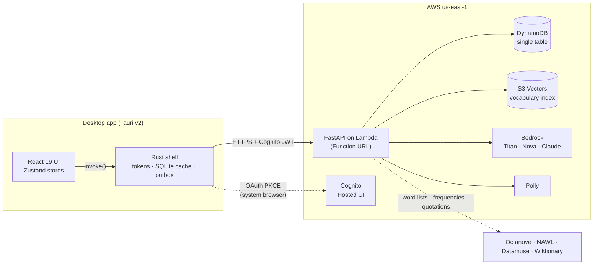

<p align="center">
  
</p>

# Lexicon

**An adaptive vocabulary tutor for fluent adult English speakers: words that get harder as you
get better.**

Lexicon teaches advanced vocabulary (roughly CEFR B2/C1 up to rare, literary words), not the
basics. Instead of a fixed deck, its vocabulary is **generated**: it pulls headwords from online
word lists, has an LLM on Amazon Bedrock write a full dictionary entry for each one, stores them
as embeddings in **Amazon S3 Vectors**, and adds more on demand whenever a learner runs low on
words at their level. Every exercise is graded by the app, not self-rated, and a spaced-repetition
scheduler (FSRS) decides when each word comes back.

It ships as a **desktop app** (React UI in a Tauri shell) backed by a **Python API on AWS
Lambda**. A web/PWA build of the same UI is prepared but not hosted yet.

---

## Contents

- [What it does](#what-it-does)
- [How studying works](#how-studying-works)
- [Architecture](#architecture)
- [Repository structure](#repository-structure)
- [Data model](#data-model)
- [AI models and services](#ai-models-and-services)
- [API](#api)
- [Testing and CI](#testing-and-ci)
- [Setup](#setup) · [Quick start](#quick-start-local) · [Deploying](#deploying)

---

## What it does

The desktop app has four tabs:

| Tab | What it's for |
|---|---|
| **Study** | Adaptive sessions: due reviews mixed with ~6 new words just above your level, each graded on the server. |
| **Add words** | Paste text or a link from something you're reading; Lexicon picks the words worth learning at your level and puts them first in your next sessions. |
| **Progress** | Your level over time, reviews due in the next 7 days, and the words you keep missing. |
| **Search** | Semantic search over the vocabulary, plus a RAG tutor you can ask questions. |

The header shows your **level** (a 0–100 estimate), day streak, words studied and reviews due.

## How studying works

**Your level.** Every word has a difficulty from 0 to 100 (50 ≈ *ubiquitous*, 70 ≈
*perspicacious*, 85 ≈ *tergiversate*). Your level moves Elo-style on the first answer to each word
in a session: surprising results move it more, and multiple-choice answers are discounted for
guessing. New words come from the band just above your level, `[level, level + 12)`.

**Choosing new words** (`python/lexicon/session.py`, `pick_new_words`):
1. Words you **imported** from your own reading come first.
2. About half of the rest are neighbours (in embedding space) of words you recently mastered;
   the others are random picks from the band.
3. They are **spaced out**: near-synonyms (listed synonyms, the same word family, or Titan
   cosine similarity ≥ 0.6) are never introduced in the same session, or alongside a word you're
   still relearning, because words that mean nearly the same thing interfere when learned together.
4. If the band runs short, the vocabulary pool is topped up on the spot (see
   [vocabulary pipeline](#vocabulary-pipeline)).

**Exercises get harder as a word gets stronger** (by FSRS stability, in days):

| Stage | Exercise |
|---|---|
| New word | **Pick the definition** (4 options; wrong ones are definitions of nearby words) |
| Learning, stability < 7 | **Pick the word** for a definition |
| 7–30 days | **Fill the blank** in a sentence, or **which word fits best?** (the word vs. its near-synonyms, with the nuance explained afterwards) |
| 30+ days | **Type the word** from its definition (only the letter count as a hint past 60 days), or **write your own sentence** using it, graded by Nova Pro as correct / partly right / incorrect, with a corrected version |

Fill-the-blank sentences are either freshly generated by Nova Pro or, about half the time, **real
example sentences from Wiktionary** (credited on screen). Wrong options come from the word's S3
Vectors neighbours, excluding synonyms and preferring the same part of speech, so they can't be
ruled out on grammar alone.

**Getting it wrong is a lesson.** A miss shows the full entry (definition, three examples,
synonyms, commonly confused words, origin, where you met it for imported words), a **teaching
card** (IPA, word parts, a memory hook; written once per word by Claude Sonnet and stored), and an
optional "why was that wrong?" explanation. The word comes back three cards later as a different
exercise until you get it right. Every entry has **pronunciation audio** (Amazon Polly).

**Being lenient where it's fair.** A new word you get right on sight must be confirmed by typing
before it counts as known. Typing a near-synonym instead of the word gets one ungraded retry;
small typos are accepted but rated *Hard*.

**Scheduling.** Each word is rated in FSRS once per session (*Again*, *Hard*, *Good* or *Easy*);
repetition within a session is the session queue's job. **Grading happens on the server and the
answer key never reaches the client.**

---

## Architecture



The design rules:

- **The UI never calls AI or AWS directly.** On desktop every request goes through the Rust shell,
  which attaches the Cognito token. The same UI can run in a browser through a `fetch`-based
  transport (`apps/web/src/lib/transport.ts`).
- **The Rust shell stays thin.** It handles sign-in (OAuth 2.0 + PKCE in the system browser,
  never the WebView), keeps the refresh token in the OS keychain, caches progress in local SQLite
  and queues reviews made offline. It has no learning logic.
- **Python owns all logic:** retrieval, enrichment, sessions, grading, scheduling and progress.
  Bedrock generation dominates latency, so Lambda's Python cold start doesn't matter, and `boto3`
  is the reference SDK for S3 Vectors and Bedrock.
- **The Lambda is stateless.** Session state (queue, current exercise, answer key) lives in
  DynamoDB with a 2-day TTL.

### Vocabulary pipeline

Vocabulary grows in two stages, so the expensive one only runs when a learner needs words
(`python/lexicon/refill.py`):

1. **Sources → candidate pool** (cheap; CLI or scheduled): fetch curated advanced word lists
   (Octanove C1/C2, the New Academic Word List, or your own), score each headword's difficulty
   from its source and its Datamuse frequency, have Nova Pro batch-rate them (~50 per call) and
   flag junk, and park them in DynamoDB by difficulty.
2. **Pool → published terms** (on demand, from the API): when fewer than enough unseen words sit in
   a learner's band, enrich candidates from that band with Claude Sonnet (definition, examples,
   synonyms, confusables, etymology, difficulty; the model may also reject a word), embed them with
   Titan, and write them to S3 Vectors and the term index. If the lists run dry, Nova suggests new
   words at that difficulty, verified against Datamuse before use.

Imported words (*Add words* tab) skip the pool: they are enriched and published immediately, then
queued for that learner.

---

## Repository structure

```
apps/
  web/                       React 19 + TypeScript + Vite + Zustand (the UI, shared by desktop and web)
    src/components/          StudyPanel, ImportPanel, ProgressPanel, SearchPanel
    src/stores/              useSessionStore (study sessions), useVocabStore (stats), useAuthStore
    src/lib/                 transport.ts (Tauri vs fetch), types.ts (mirrors the Python models),
                             auth.ts (web Cognito), audio.ts (pronunciation playback)
    public/, src/assets/     favicon and header logo
  desktop/                   Tauri v2 shell
    app-icon.svg             icon source: `npx tauri icon app-icon.svg` regenerates src-tauri/icons
    src-tauri/src/
      lib.rs                 invoke() commands: thin passthroughs to the API + token refresh on 401
      auth.rs                Cognito Hosted UI sign-in (Authorization Code + PKCE, loopback redirect)
      secrets.rs             refresh token in the OS keychain (0600 file fallback on Linux)
      store.rs               local SQLite: progress cache + offline review outbox
python/
  lexicon/                   the runtime: API, sessions, vocabulary pipeline, CLI (see below)
  tests/                     pytest suite (no AWS or network needed)
infra/
  cdk/                       AWS CDK (Python): Cognito, DynamoDB, Lambda + Function URL, IAM
  bootstrap_s3vectors.py     one-time S3 Vectors bucket + index setup (kept out of CDK; see file)
  iam/deployer-policy.json   least-privilege policy for the person or role that deploys
data/                        schema notes and seed vocabulary (JSONL)
docs/                        setup.md (AWS + OAuth), smoke-test.md
scripts/smoke_test.py        read-only health check of a deployed environment
.github/workflows/ci.yml     CI: Python, web, Rust
Makefile                     shortcuts; `make ci` runs what CI runs
prompt.md                    original product spec and architecture decisions
```

### The Python package (`python/lexicon`)

| Area | Modules |
|---|---|
| **API** | `api.py` (FastAPI routes; Mangum adapter for Lambda), `auth.py` (Cognito JWT verification), `cognito.py` (Hosted UI helpers), `config.py` (settings from `LEXICON_*` env vars), `logging_setup.py` |
| **Study sessions** | `session.py` (session engine: word selection, exercise building, grading, level updates), `srs.py` (FSRS wrapper), `progress.py` (streaks and counts derived from progress) |
| **Teaching** | `lesson.py` (teaching cards), `quotations.py` (Wiktionary sentences), `speech.py` (Polly audio), `tutor_agent.py` (RAG tutor), `retriever.py` (filtered semantic search) |
| **Learner tools** | `importer.py` (words from pasted text or a URL; refuses non-public addresses), `overview.py` (progress page) |
| **Vocabulary pipeline** | `sources.py` (word lists), `difficulty.py` (0–100 scoring, Datamuse frequency), `rating.py` (batch difficulty rating), `suggest.py` (Bedrock-suggested words), `enrichment.py` (headword → full entry), `refill.py` (pool → published terms) |
| **Storage** | `dynamo.py` (progress, aggregates, sessions, import queue), `termindex.py` (term index + candidate pool), `vectorstore.py` (S3 Vectors), `bedrock.py` (all Bedrock calls) |
| **Other** | `models.py` (shared Pydantic models), `privacy.py` (data export + account deletion), `ingestion.py` (bulk seeding), `decks.py` (the original deck/quiz flow; its API routes remain but the current UI doesn't use them), `__main__.py` (CLI) |

---

## Data model

### DynamoDB (one table, `lexicon`, on-demand billing)

| Item | PK | SK | Notes |
|---|---|---|---|
| Progress for one word | `USER#<sub>` | `PROGRESS#<term_id>` | FSRS state: stability, difficulty, due, reps, lapses |
| Aggregate | `USER#<sub>` | `AGGREGATE` | level, level history, streaks, counts; derived from progress |
| Study session | `USER#<sub>` | `SESSION#<id>` | queue, current exercise with its answer key, graded answers; `ttl` = 2 days |
| Imported word | `USER#<sub>` | `QUEUE#<term_id>` | the sentence it was met in and where it came from |
| User list | `USER#<sub>` | `LIST#<list_id>` | |
| Term | `TERM#<term_id>` | `META` | full entry, teaching card, cached quotations; `status` active or skipped |
| Term by difficulty | `TERMS#<domain>` | `D#<ddd>#<term_id>` | answers "which words are in band [lo, hi)?" with a key range |
| Candidate | `CANDIDATE#<domain>` | `D#<ddd>#<slug>` | un-enriched headword waiting in the pool |

`<sub>` is the Cognito user id, taken from the verified token, never from client input.

### S3 Vectors (bucket `lexicon-vectors`, index `vocabulary`)

1024-dimension Titan V2 embeddings, cosine distance. Each vector embeds the term, definition,
example and synonyms. **Filterable** metadata: `domain`, `subfield`, `difficulty_tier`,
`cefr_level`, `difficulty`, `scope`, `owner_id`, `list_id`. **Non-filterable** (returned with
results): `term`, `definition`, `example`, `synonyms`, `pos`, `source`. The richer entry lives in
DynamoDB; S3 Vectors holds what search results and distractor selection need.

### On the desktop

SQLite (`lexicon.db` in the app data directory) caches progress and queues reviews made offline;
the refresh token lives in the macOS Keychain or Windows Credential Manager.

---

## AI models and services

| Job | Model / service | Setting |
|---|---|---|
| Embeddings | Amazon Titan Text Embeddings V2 | `LEXICON_EMBED_MODEL_ID` |
| Dictionary entries, teaching cards, picking words from imported text | Claude Sonnet 4.6 (reliable etymologies; others invented them) | `LEXICON_ENRICH_MODEL_ID` |
| Batch difficulty rating | Amazon Nova Pro (ranks like Sonnet at ~1/5 the cost) | `LEXICON_RATE_MODEL_ID` |
| Exercise sentences, nuance exercises, sentence grading, "why was that wrong?" | Amazon Nova Pro | `LEXICON_EXERCISE_MODEL_ID` |
| RAG tutor, word suggestions | Amazon Nova Lite | `LEXICON_GENERATION_MODEL_ID` |
| Pronunciation | Amazon Polly (neural voice) | — |
| Word frequencies · real example sentences | Datamuse API · Wiktionary REST API | — |

Generated content is written once and stored where possible (entries, teaching cards, quotations,
explanations), so repeat learners don't pay for it again.

---

## API

FastAPI, deployed as a Lambda Function URL. Every `/v1` route requires a Cognito JWT, except that
with no user pool configured (local development) all calls run as `dev-user`.

| Endpoint | Purpose |
|---|---|
| `POST /v1/session` | start a session → `session_id`, review/new counts, level |
| `GET /v1/session/{id}/next` | next exercise (no answer), or the summary when done |
| `POST /v1/session/{id}/answer` | `{exercise_id, choice \| text}` → graded result, full entry, next step (or an ungraded nudge to retry) |
| `POST /v1/session/{id}/explain` | why the chosen answer was wrong (generated once, cached) |
| `POST /v1/session/{id}/lesson` | teaching card for a missed word |
| `GET /v1/pronounce?word=` | base64 MP3 from Polly |
| `POST /v1/import` | `{text \| url}` → words picked from the learner's reading, queued |
| `GET /v1/overview` | level history, due forecast, struggling words |
| `POST /v1/pool/prefetch` | grow the learner's next band; clients call it without awaiting |
| `GET /v1/stats` · `GET /v1/progress` · `PUT /v1/progress/{term_id}` | aggregate stats; per-word progress; record a review |
| `POST /v1/search` · `POST /v1/tutor` | semantic search; RAG tutor (`explain`, `quiz`, `compare`, `answer`) |
| `GET /v1/export` · `DELETE /v1/account` | export all of the caller's data; delete it |
| `GET /health` · `GET /v1/me` | liveness; the caller's resolved user id |

The desktop shell exposes each of these as a Tauri command of the same purpose (see `lib.rs`).

---

## Testing and CI

GitHub Actions (`.github/workflows/ci.yml`) runs on every push to `main` and on pull requests:

| Job | Checks |
|---|---|
| **python** | `ruff`, `mypy`, `pytest`. Tests use in-memory fakes for DynamoDB, S3 Vectors and Bedrock, so they need no AWS access or network. |
| **web** | TypeScript type-check + production build |
| **rust** | `cargo fmt --check`, `cargo clippy -D warnings`, `cargo test` (on Ubuntu 24.04 with Tauri's GTK/WebKit libraries) |

A second workflow, `.github/workflows/windows-build.yml`, builds the **Windows installer** (NSIS
`.exe`) on every push to `main`, or on demand from the Actions tab, and attaches it to the run for
14 days. It isn't run on pull requests: a release build takes 10–15 minutes and Windows minutes
count double on a private repo. The installer is unsigned, so Windows SmartScreen will warn on
first launch (*More info → Run anyway*).

Run the CI checks locally with `make ci`. To check a deployed environment without changing anything:

```bash
python/.venv/bin/python scripts/smoke_test.py
```

---

## Setup

[`docs/setup.md`](./docs/setup.md) covers the AWS side (Bedrock model access, S3 Vectors, CDK
deploy, IAM permissions) and optional Google/GitHub sign-in; then work through
[`docs/smoke-test.md`](./docs/smoke-test.md). Sign-in is Cognito email/password by default;
Google and GitHub are enabled by passing their client ids to `cdk deploy`.

## Quick start (local)

```bash
# Python
cd python
python -m venv .venv && source .venv/bin/activate
pip install -e ".[dev]"
pytest
ruff check . && mypy lexicon

# Vocabulary grows on demand from online word lists (Octanove C1/C2 + NAWL):
#   1. fetch + score headwords into the DynamoDB candidate pool
python -m lexicon sync-sources
#      add your own list: --list gre=./gre.txt@80   (one word per line, 0-100 baseline)
#   2. enrich a difficulty band via Bedrock -> S3 Vectors + term index
#      (the API does this automatically when a learner's band runs low)
python -m lexicon refill --lo 60 --hi 70 --count 8
#      when a band has too few candidates, Bedrock suggests new words first
#      (verified against Datamuse); --no-suggest disables that
python -m lexicon suggest --lo 80 --hi 90 --count 15   # suggestions only, no enrichment
python -m lexicon pool    # terms vs pending candidates per band

# Search (filters work on both), and the RAG tutor
python -m lexicon search "grounding a model in sources" --domain ai --tier advanced
python -m lexicon ask "quiz me on advanced AI terms" --mode quiz --domain ai

# Web
cd apps/web
npm install
npm run dev

# Desktop (requires Rust + Tauri prerequisites)
cd apps/desktop
npm install
npm run tauri dev
```

The desktop shell reads its settings from the environment, not from a `.env` file. Export these
before `npm run tauri dev` (the values are in `python/.env`):

```bash
export LEXICON_API_BASE='<ApiUrl>'
export LEXICON_COGNITO_DOMAIN='<CognitoHostedUiDomain>'
export LEXICON_COGNITO_CLIENT_ID='<UserPoolClientId>'
export LEXICON_COGNITO_CALLBACK_URL='http://127.0.0.1:4200/callback'
```

Developer tools stay closed at start; set `LEXICON_DEVTOOLS=1` to open them automatically.

## Deploying

```bash
cd infra/cdk
source .venv/bin/activate
cdk diff      # review first
cdk deploy
```

Docker must be running: CDK builds the Lambda package in a container. Context flags (`dev`,
Google/GitHub client ids, extra callback URLs) aren't saved between deploys, so pass the same
ones every time; leaving one out removes what it configured. See `docs/setup.md`.
